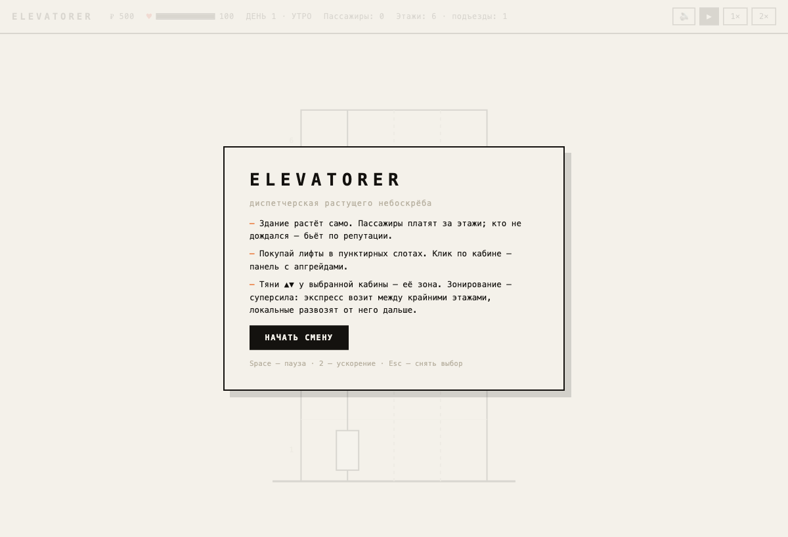
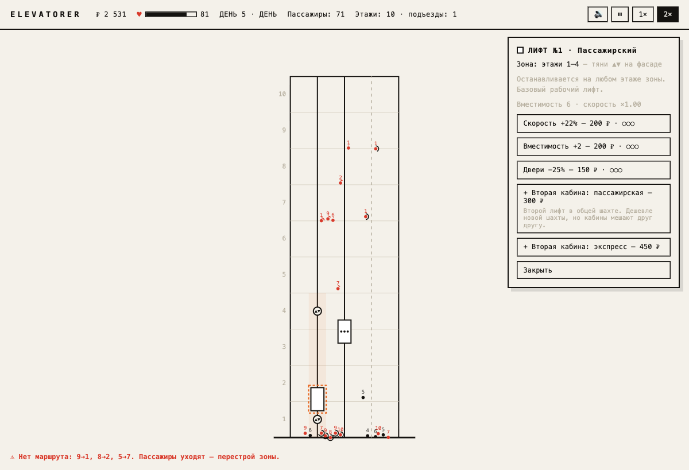
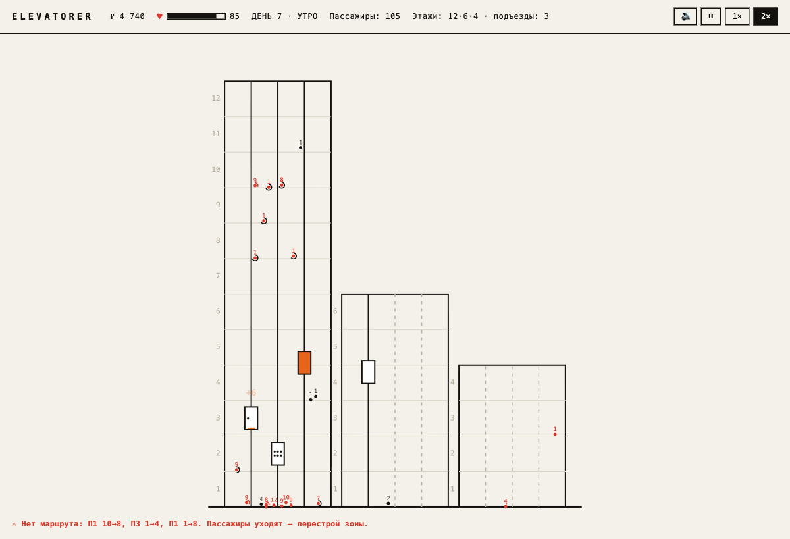

# 🛗 Elevatorer

**Мини-стратегия в духе Mini Metro, только вместо метро — лифты растущего небоскрёба.**
Здание само прибавляет этажи, пассажиры капают деньгами, а ты — главный инженер:
покупаешь лифты, задаёшь им зоны этажей и держишь репутацию на плаву.

<p align="center">
  
  
  
</p>
<p align="center">
  <sub>слева направо: смена начинается · зонирование «1–4 + партнёр выше» · скайлайн 12·6·4</sub>
</p>

## 🎮 Играть онлайн

**[https://romananchugov.github.io/elevatorer/](https://romananchugov.github.io/elevatorer/)**

Игра запекается в один самодостаточный HTML-файл (~45 КБ) и публикуется командой
`npm run bake` (сборка + копия в Pages-репо + пуш). Файл работает и локально —
можно просто открыть его двойным кликом.

## Запуск

```bash
npm install
npm run dev      # http://localhost:5173
npm run build    # прод-сборка в dist/
npm run bake     # запечь в один HTML и опубликовать на Pages
```

## Как играть

- **Здание растёт само, и каждый подъезд — со своей этажностью**: главный
  прибавляет этаж каждый день, соседи медленнее и ниже. На 6-й и 12-й день
  въезжают новые подъезды (невысокие, спрос в них разгоняется постепенно —
  вложись в лифт, пока они маленькие!). Пассажиры платят за пройденные этажи
  (в час пик ×1.5); кто не дождался — бьёт по репутации. Репутация на нуле —
  смена окончена.
- **Пунктирные слоты** — свободные шахты. Клик → покупка лифта:
  - **Пассажирский** (400 ₽) — останавливается на любом этаже своей зоны;
  - **Экспресс** (600 ₽) — ×2.5 скорость, но только крайние этажи зоны
    (классическое «небесное лобби» — довозит до верха, дальше локальные).
- **Клик по кабине** — панель: апгрейды (скорость / вместимость / двери) и
  вторая кабина в общей шахте (дешевле новой шахты, но кабины мешают друг другу).
  Подъезды независимы: у каждого свои шахты и свои пассажиры.
- **Тяни ▲▼ на фасаде** у выбранной кабины — её зона этажей. Бесплатно и мгновенно,
  можно на паузе. Зонирование — главная суперсила: `локальный 1–4 + экспресс 1↔6 +
  локальный 5–6` — и пассажиры ездят с пересадками, как в настоящем небоскрёбе.
- **Space** — пауза, **2** — ускорение, **M** — звук, **Esc** — снять выбор.

## Архитектура

TypeScript + Vite + Canvas 2D, без движка. Фиксированный шаг симуляции 30 Гц,
рендер каждый кадр. Все балансовые числа — в `src/config.ts`.

```
src/
  main.ts            игровой цикл (аккумулятор шага + рендер)
  config.ts          весь баланс: цены, фазы дня, скорости, репутация
  types.ts           домен: Game, Shaft, Cab, Passenger, Effect
  game.ts            фабрика новой партии
  sim/
    potential.ts     BFS-маршрутизация с пересадками (pot = мин. число поездок),
                     считается отдельно для каждого подъезда
    building.ts      въезд новых подъездов по вехам этажей
    cab.ts           диспетчер SCAN: вызовы, направление, двери, посадка/высадка
    spawn.ts         генерация пассажиров по фазам дня (утро вверх / вечер вниз)
    economy.ts       деньги, репутация, покупки, апгрейды
    step.ts          такт симуляции: день, рост, терпение, эффекты
    util.ts          геометрия подъездов и этажей, фаза суток
  render/
    camera.ts        вписывание здания в экран
    draw.ts          вся графика: линии, кабины, пассажиры, эффекты
  input.ts           клики, drag ручек зоны, клавиатура
  ui/hud.ts          топбар, панель кабины, меню покупки, оверлеи, подсказки
```

Ключевая механика — `potential.ts`: для каждой цели считается минимальное число
поездок от любого этажа (граф = зоны лифов; экспресс соединяет только крайние).
Пассажир садится лишь в поездку, строго уменьшающую потенциал, и только по
направлению движения кабины. Отсюда сами собой рождаются зонирование и ски-лобби.

Звук — генеративный, на Web Audio без файлов (`src/audio.ts`): «плюки» доставок
играют восходящую пентатонику каскадом (при наплыве складываются в нежную гамму),
а короткое тёмное эхо даёт нотам хвост и ощущение пространства — минималистичная
музыка без давящего низкого фона. Кнопка 🔊 / клавиша **M**.

## Дорожная карта (дальше)

- Мостики между подъездами: маршруты «лифт → мостик → лифт»
- Грузовые и VIP-пассажиры, события-встряски («пожарная тревога»)
- Сохранение/загрузка, статистика партий
- Эмбиент-пад по фазам дня
